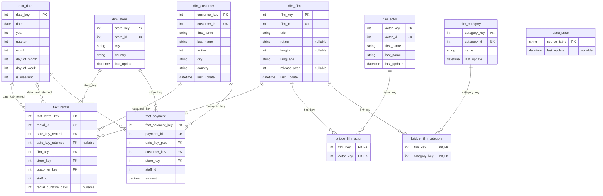

# databases-hw4

Sakila (MySQL 8.0) -> SQLite analytics sync built with SQLAlchemy.

## Stack

| Item | Version |
| ---- | ------- |
| Language | Python 3.10.12 |
| ORM | SQLAlchemy 2.0.57 (`>=2.0,<2.1`) |
| MySQL driver | PyMySQL 1.2.4 (+ cryptography 50.0.2 for MySQL 8 auth) |
| Source DB | MySQL 8.0, official Sakila sample |
| Target DB | SQLite file |
| Tests | pytest 8.4.2 |
| Config | python-dotenv 1.2.4 |

## Setup

```bash
python3 -m venv .venv
source .venv/bin/activate
pip install -r requirements.txt
cp .env.example .env   # fill in MySQL credentials
```

### MySQL databases

You need a running MySQL 8.0 server, a MySQL admin account (for step 1), and the official Sakila files `sakila-schema.sql` and `sakila-data.sql`. The commands below assume those two files are in the directory above this repo (`../`). Adjust the paths if yours are elsewhere. Commands use GNU `sed` (Linux/WSL).

**1. Create an app user** (as a MySQL admin) with access to the source and the test database. Replace `choose-a-password`:

```bash
sudo mysql -e "CREATE USER 'sakila_app'@'localhost' IDENTIFIED BY 'choose-a-password'; GRANT ALL ON sakila.* TO 'sakila_app'@'localhost'; GRANT ALL ON sakila_test.* TO 'sakila_app'@'localhost';"
```

(Use `mysql -u root -p -e "..."` instead of `sudo mysql` if your admin account has a password.)

**2. Load the source database `sakila`** as the MySQL admin, not `sakila_app`. The data file creates triggers, which needs the SUPER privilege when binary logging is on; as `sakila_app` the load stops at the `film` table with `ERROR 1419`. The schema file drops and recreates `sakila`, so the grants from step 1 stay in place.

```bash
sudo mysql < ../sakila-schema.sql
sudo mysql sakila < ../sakila-data.sql
```

**3. Create the test copy `sakila_test`** (same schema, database name swapped). The tests copy the data from `sakila` into it before each test, so it only needs the schema:

```bash
sed 's/\bsakila\b/sakila_test/g' ../sakila-schema.sql | sudo mysql
```

(Use `mysql -u root -p` instead of `sudo mysql` in steps 2 and 3 if your admin account has a password.)

**4. Check:** both commands should list 23 entries (16 tables and 7 views), and `sakila` should hold 1000 films, 16044 rentals and 16044 payments.

```bash
mysql -u sakila_app -p sakila -e "SHOW TABLES"
mysql -u sakila_app -p sakila_test -e "SHOW TABLES"
```

Then set `MYSQL_USER=sakila_app` and your password from step 1 in `.env`.

## Environment variables

All connection settings come from the environment (loaded from `.env`, which is git-ignored).

| Variable | Purpose |
| -------- | ------- |
| `MYSQL_HOST`, `MYSQL_PORT` | MySQL server location |
| `MYSQL_USER`, `MYSQL_PASSWORD` | MySQL credentials |
| `MYSQL_DATABASE` | Source Sakila database (`sakila`) |
| `MYSQL_TEST_DATABASE` | Separate Sakila copy used by tests (`sakila_test`) |
| `SQLITE_PATH` | Analytics SQLite file |
| `SQLITE_TEST_PATH` | SQLite file used by tests (tests override it with a temp file) |

## Usage

```bash
python -m sakila_sync init
python -m sakila_sync full-load
python -m sakila_sync incremental
python -m sakila_sync validate [--from YYYY-MM-DD] [--to YYYY-MM-DD]
pytest -v
```


## ER diagram



## Indexes

All indexes are declared on the ORM models.

**Unique indexes on natural keys.** They enforce one row per Sakila ID and make the upsert lookups fast.

| Table | Column |
| ----- | ------ |
| `dim_film` | `film_id` |
| `dim_actor` | `actor_id` |
| `dim_category` | `category_id` |
| `dim_store` | `store_id` |
| `dim_customer` | `customer_id` |
| `fact_rental` | `rental_id` |
| `fact_payment` | `payment_id` |

The bridge tables' composite primary key (`film_key` + `actor_key` | `film_key` + `category_key`) prevents duplicate links.

**Secondary indexes**:

| Index | Purpose |
| ----- | ------- |
| `idx_fact_rental_date_key_rented`, `idx_fact_rental_date_key_returned` | Filter and group rentals by date |
| `idx_fact_rental_film_key`, `_store_key`, `_customer_key` | Join rentals to dimensions |
| `idx_fact_payment_date_key_paid` | Filter and group payments by date |
| `idx_fact_payment_customer_key`, `_store_key` | Join payments to dimensions |
| `idx_bridge_film_actor_actor_key` | The primary key covers film -> actors, and this covers actor -> films |
| `idx_bridge_film_category_category_key` | The primary key covers film -> category, and this covers category -> film |

## Raw SQL

One statement, in test setup only (`tests/conftest.py`): `SET FOREIGN_KEY_CHECKS=0` while resetting `sakila_test`. Sakila's `store` and `staff` tables reference each other, and SQLAlchemy has no ORM construct for this session variable.

## AI usage

I used AI (Claude Sonnet 5.5) to polish code and markdown text for readability, to write repetitive code, to put the ERD in mermaid, and to help me understand how to write ORM code and structure the repository where I was unsure. However, I developed the ideas and core logic of the ORM myself. I learned how to balance creative thinking and judgement when working on a project, as AI often times messes up in converting my ideas into code. I also added a harness to the repo that stops the AI from reading confidential secrets in the environment.
